# Cloud Lab 2 Submission — Load Balancer and Auto Scaling

Copy this template to `cc-lab-YOUR_ID/lab2/README.md` in your own repository. Follow [the instructions](lab2-instruction.md). Put your screenshots in `lab2/images/` with the file names below.

- **Student name:** SARITH Seyla
- **Student ID:** e20221116
- **Learner Lab user name:** SARITH_SEYLA
- **Date completed:** 03/November/2026

---

## Security groups

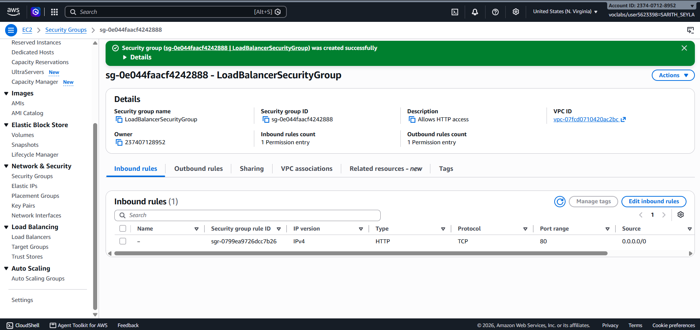

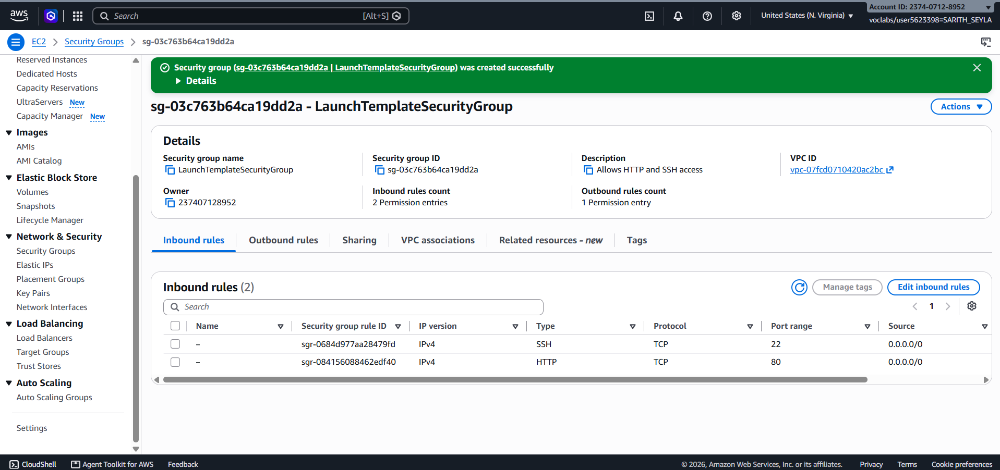

## Target group

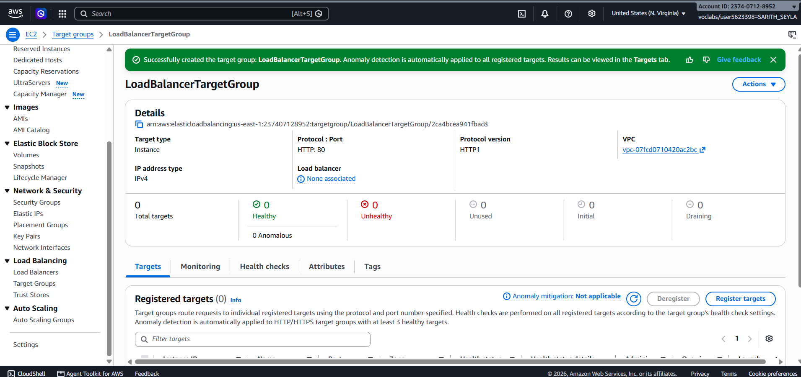

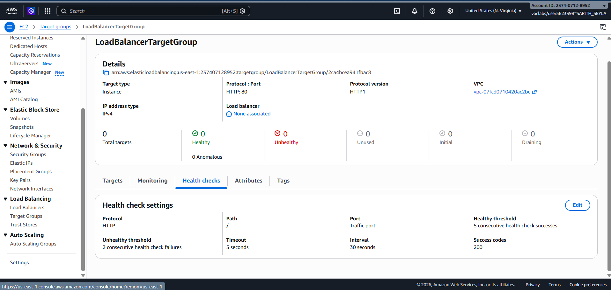

## Application Load Balancer

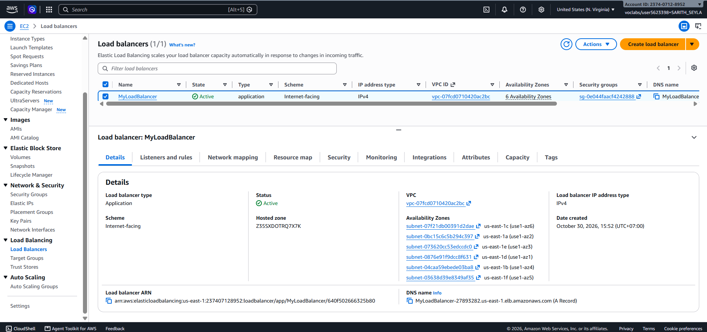

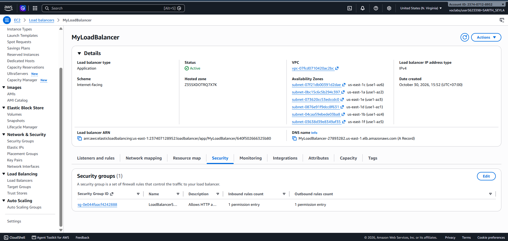

## Launch template

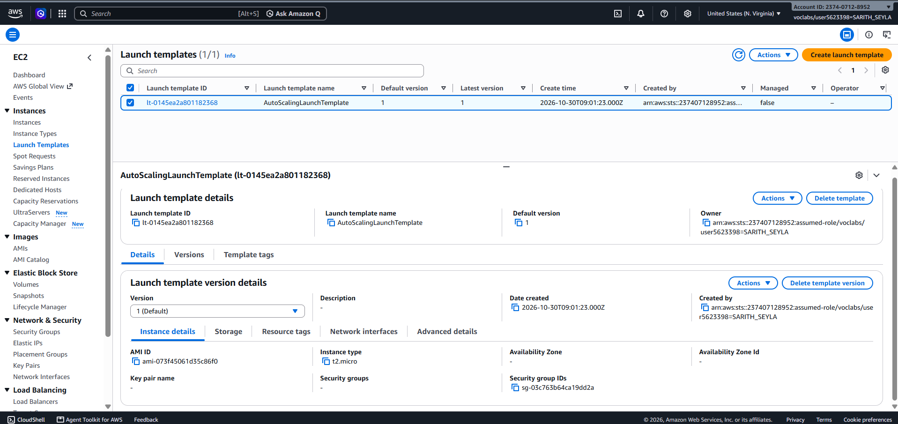

## Auto Scaling group

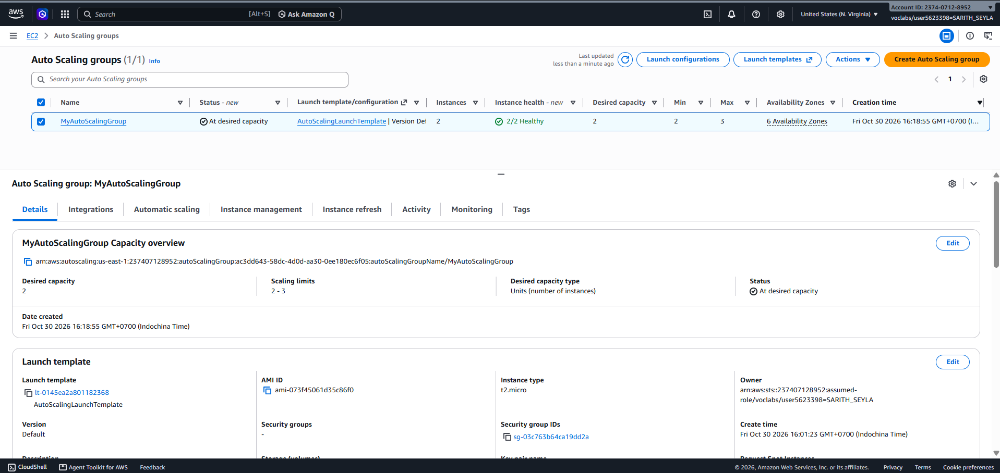

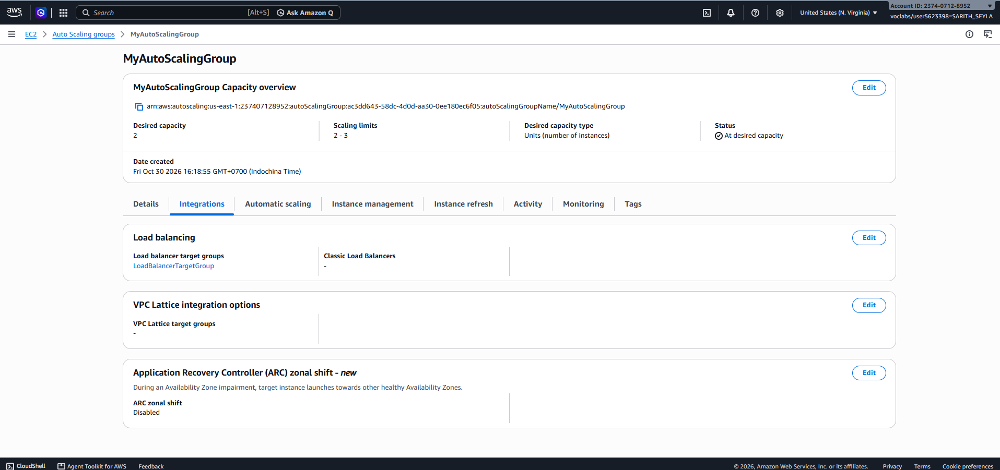

## Load balancing test

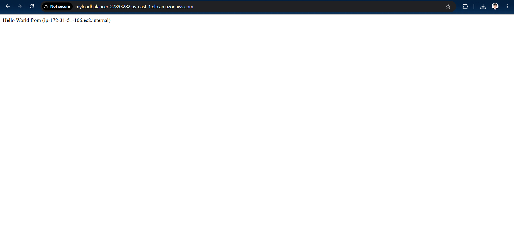

## Simulated application failure

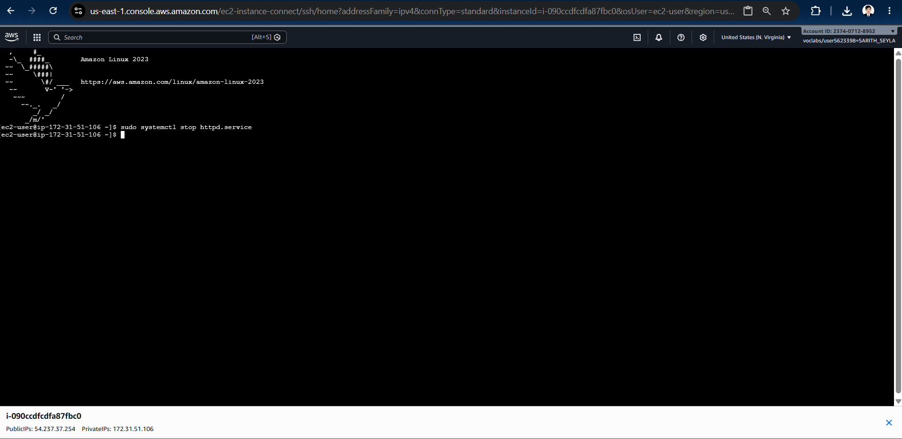

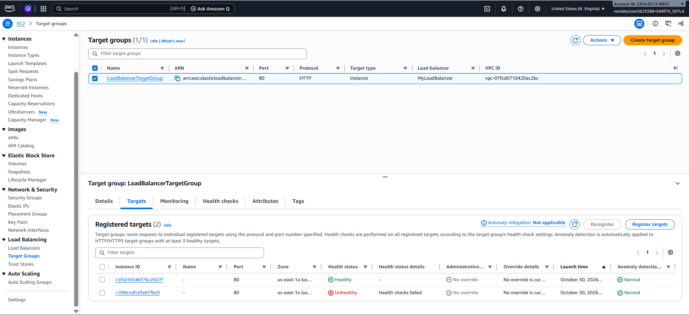

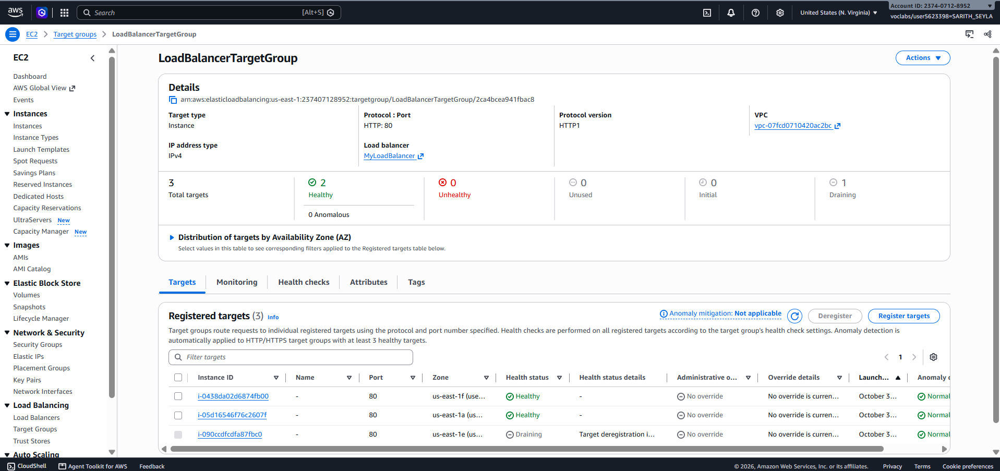

About how many minutes passed between stopping `httpd` and the new instance becoming healthy?

---

## Questions

1. Why does the page show a different host name when you refresh it?
2. After you stopped `httpd`, the instance was still *running* in EC2, but the target group marked it *unhealthy*. What did the health check test, and why did the instance fail it?
3. Who replaced the failed instance: the load balancer, the target group, or the Auto Scaling group? Explain the role of each one.
4. With desired 2, minimum 2 and maximum 3, how many instances run normally? In what situation could there be 3?
5. The instances' security group allows HTTP from anywhere. How could you change it so that the instances accept HTTP **only** from the load balancer?

## Answers

1. Because the load balancer shares the web traffic across multiple servers, SO when I refresh the page, the load balancer sends my request to a different server. Since each server has its own unique name, the name on the page changes.

2. The health check tested if the web server software (`httpd`) was actively answering web requests. It failed because stopping `httpd` meant the server could no longer reply to the check. The EC2 instance was still running, but the specific web application on it was off.

3. The **Auto Scaling group** replaced the failed instance. 
   - **Load Balancer:** Only directs traffic to healthy servers. It does not create or delete servers.
   - **Target Group:** Runs the health checks and reports to the Auto Scaling group if a server is broken.
   - **Auto Scaling Group:** Listens to the health reports, deletes the broken server, and automatically creates a new one to maintain the correct number of servers.

4. Normally, **2** instances run because the "desired" capacity is 2. There could be **3** instances if there is a sudden spike in website traffic, and an auto-scaling rule triggers the system to add one extra server to handle the heavy load, up to the maximum limit.

5. I go to the security group attached to the EC2 instances (`LaunchTemplateSecurityGroup`). Edit the inbound HTTP (port 80) rule and change the "Source" from `0.0.0.0/0` (Anywhere) to the **Security Group ID of the Load Balancer** (`LoadBalancerSecurityGroup`). This acts like a VIP list, ensuring only the load balancer is allowed to send traffic to the instances.

## Clean up

- [x] `MyAutoScalingGroup` deleted and its instances terminated.
- [x] `AutoScalingLaunchTemplate` deleted.
- [x] `MyLoadBalancer` and `LoadBalancerTargetGroup` deleted.
- [x] Both security groups deleted.